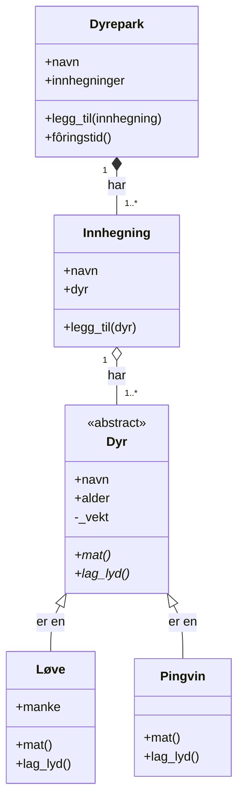

# Objektorientert programmering (OOP)

I objektorientert programmering organiserer vi koden rundt **objekter**: ting som har egenskaper (data) og som kan gjøre noe (oppførsel). I stedet for løse variabler og funksjoner samler vi det som hører sammen.

Gjennomgående eksempel: en **dyrepark** som skal holde oversikt over dyrene sine.

## Innhold

1. [Grunnbegreper](#grunnbegreper)
2. [Modularitet og innkapsling](#modularitet-og-innkapsling)
3. [Arv](#arv)
4. [Polymorfisme](#polymorfisme)
5. [Abstraksjon](#abstraksjon)
6. [Tillegg: moduler i Python](#tillegg-moduler-i-python)
7. [Modellering](#modellering)
8. [Oppsummering](#oppsummering)
9. [Eksempler i denne mappen](#eksempler-i-denne-mappen)

## Grunnbegreper

| Begrep | Forklaring | Dyrepark-eksempel |
|---|---|---|
| **Klasse** | En mal/oppskrift for å lage objekter | `Dyr` |
| **Objekt / instans** | Et konkret eksemplar laget fra klassen | løven `simba` |
| **Attributt** | Data som hører til objektet | `navn`, `alder` |
| **Metode** | En funksjon som hører til klassen | `spis()` |
| **Konstruktør** | `__init__`, kjøres når objektet lages | setter navn og alder |
| **`self`** | Referanse til objektet selv | `self.navn` |

```python
class Dyr:
    def __init__(self, navn, alder):
        self.navn = navn      # attributt
        self.alder = alder

    def spis(self):           # metode
        print(f"{self.navn} spiser.")

simba = Dyr("Simba", 4)       # objekt (instans) av klassen Dyr
nala = Dyr("Nala", 3)         # et annet objekt, samme klasse
simba.spis()                  # Simba spiser.
```

Én klasse, mange objekter: hvert dyr har sine egne verdier, men samme oppførsel.

## Modularitet og innkapsling

**Hva det betyr:** Data (attributter) og funksjonalitet (metoder) samles i én enhet, et objekt. Tilgangen til de interne dataene begrenses, slik at resten av programmet bare bruker objektet gjennom metodene.

**Fordel:** Koden beskyttes mot uventede endringer utenfra. Hvis du endrer hvordan en klasse fungerer *internt*, påvirker det ikke resten av programmet, så lenge det *eksterne grensesnittet* (metodene andre bruker) er det samme.

Mange språk (f.eks. Java) har tilgangsstyrere som `private` og `protected`. Python har ikke det, men bruker navnekonvensjoner:

| Skrivemåte | Betydning |
|---|---|
| `navn` | Offentlig: fritt fram |
| `_vekt` | «Intern», tilsvarer omtrent `protected`. En avtale: ikke bruk utenfra |
| `__vekt` | Tilsvarer omtrent `private`. Python endrer navnet internt, så det er vanskeligere å nå utenfra |

```python
class Dyr:
    def __init__(self, navn, vekt):
        self.navn = navn
        self._vekt = vekt     # intern: ikke rør direkte

    def hent_vekt(self):
        return self._vekt

    def registrer_vekt(self, ny_vekt):
        if ny_vekt <= 0:
            print("Ugyldig vekt!")
            return
        self._vekt = ny_vekt
```

- **Beskyttelse:** Dyrepasseren kan ikke ved et uhell sette vekten til `-50`, fordi klassen kontrollerer endringen.
- **Stabilt grensesnitt:** Hvis vi senere vil lagre vekten i gram i stedet for kilo, endrer vi bare innsiden av klassen. Resten av programmet bruker fortsatt `hent_vekt()` og `registrer_vekt()`, og merker ingenting.
- **Modulært:** Alt som har med et dyr å gjøre, ligger samlet i `Dyr`. Klassen er en selvstendig byggekloss.

## Arv

Med arv kan en klasse (**subklasse**) bygge videre på en annen klasse (**superklasse**). Subklassen får alt superklassen har, og kan legge til eller endre ting. Arv passer når vi kan si «X **er en** Y»: en løve *er et* dyr.

```python
class Dyr:
    def __init__(self, navn, alder):
        self.navn = navn
        self.alder = alder

    def spis(self):
        print(f"{self.navn} spiser.")

class Løve(Dyr):
    def __init__(self, navn, alder, manke):
        super().__init__(navn, alder)   # la Dyr ordne navn og alder
        self.manke = manke              # nytt attributt bare for løver

    def brøl(self):                     # ny metode bare for løver
        print(f"{self.navn} brøler: ROOOAR!")

class Pingvin(Dyr):
    def svøm(self):
        print(f"{self.navn} svømmer.")

simba = Løve("Simba", 4, manke=True)
simba.spis()    # arvet fra Dyr
simba.brøl()    # egen metode
```

Fellestrekk skrives **én gang** i `Dyr`, og vi slipper å gjenta kode.

## Polymorfisme

Polymorfisme («mange former») betyr at ulike klasser kan ha **metoder med samme navn**, men som gjør forskjellige ting. Koden som bruker objektene trenger ikke vite hvilken type dyr det er.

```python
class Dyr:
    def __init__(self, navn):
        self.navn = navn

    def lag_lyd(self):
        print(f"{self.navn} lager en lyd.")

class Løve(Dyr):
    def lag_lyd(self):                  # overstyrer metoden fra Dyr
        print(f"{self.navn}: ROOOAR!")

class Pingvin(Dyr):
    def lag_lyd(self):
        print(f"{self.navn}: Kvekk-kvekk!")

class Elefant(Dyr):
    def lag_lyd(self):
        print(f"{self.navn}: Prrrøøø!")

dyrene = [Løve("Simba"), Pingvin("Pingu"), Elefant("Dumbo")]

for dyr in dyrene:
    dyr.lag_lyd()       # riktig lyd for hvert dyr
```

Løkka er den samme uansett hvor mange dyretyper parken får. Nye dyr = ny klasse, ingen endring i løkka.

## Abstraksjon

**Hva det betyr:** Komplekse implementasjonsdetaljer skjules, og brukeren av klassen ser bare det som er nødvendig.

**Fordel:** Det blir enklere for den som skal bruke koden. Du trenger ikke vite hvordan en bilmotor fungerer i detalj for å kjøre bil, det holder å kjenne til rattet og pedalene.

I dyreparken trenger dyrepasseren bare å kalle `mat()`. Hvordan porsjonen regnes ut, er skjult inne i klassen:

```python
class Løve:
    def __init__(self, navn, vekt):
        self.navn = navn
        self._vekt = vekt

    def _beregn_porsjon(self):          # detalj: brukeren trenger ikke vite om denne
        return round(self._vekt * 0.04, 1)

    def mat(self):                      # dette er «rattet og pedalene»
        print(f"{self.navn} får {self._beregn_porsjon()} kg kjøtt.")

simba = Løve("Simba", 190)
simba.mat()     # Simba får 7.6 kg kjøtt.
```

> **Innkapsling eller abstraksjon?** Begrepene henger tett sammen. Innkapsling handler om å *beskytte* dataene inne i objektet. Abstraksjon handler om å *forenkle* det brukeren ser.

### Tillegg: abstrakte klasser

Vi kan gå et steg videre med en **abstrakt klasse**: en klasse som bare beskriver *hva* alle dyr må kunne, ikke *hvordan*. Man kan ikke lage objekter av den direkte, for det finnes ikke noe dyr som bare er et «dyr».

```python
from abc import ABC, abstractmethod

class Dyr(ABC):
    def __init__(self, navn):
        self.navn = navn

    @abstractmethod
    def mat(self):
        """Alle dyr MÅ ha en mat-metode."""

class Løve(Dyr):
    def mat(self):
        print(f"{self.navn} får 7 kg kjøtt.")

class Pingvin(Dyr):
    def mat(self):
        print(f"{self.navn} får 20 sild.")

# Dyr("Ukjent")     # TypeError: kan ikke lage objekt av abstrakt klasse
Løve("Simba").mat()
```

Hvis noen lager en ny dyreklasse og glemmer `mat()`, får de feilmelding med en gang, ikke et sultent dyr senere.

## Tillegg: moduler i Python

Modularitet gjelder også på et større nivå: vi kan dele programmet i **mindre, selvstendige filer** (moduler) som hver har sitt ansvar. I Python er hver `.py`-fil en modul.

```
dyrepark/
├── dyr.py          # klassene Dyr, Løve, Pingvin, ...
├── dyrepark.py     # klassen Dyrepark som holder på alle dyrene
└── main.py         # starter programmet
```

```python
# dyrepark.py
from dyr import Løve, Pingvin

class Dyrepark:
    def __init__(self, navn):
        self.navn = navn
        self.dyr = []

    def legg_til(self, dyr):
        self.dyr.append(dyr)

    def fôringstid(self):
        for dyr in self.dyr:
            dyr.mat()       # polymorfisme igjen!
```

```python
# main.py
from dyr import Løve, Pingvin
from dyrepark import Dyrepark

park = Dyrepark("Bergen Zoo")
park.legg_til(Løve("Simba"))
park.legg_til(Pingvin("Pingu"))
park.fôringstid()
```

Fordeler: lettere å finne fram, flere kan jobbe samtidig, og modulene kan gjenbrukes. Se [importering/](importering/) for et eksempel, også på `if __name__ == "__main__":`.

> **Merk:** `Dyrepark` *har* dyr, men *er* ikke et dyr. Det er derfor ikke arv, men **komposisjon** (et objekt som inneholder andre objekter).

## Modellering

Før vi skriver kode, lønner det seg å **planlegge** hvilke klasser vi trenger og hvordan de henger sammen. Det kalles å *modellere*. Modellen er en forenklet beskrivelse av virkeligheten: vi tar bare med det programmet faktisk trenger.

### Fremgangsmåte

1. **Beskriv problemet med vanlig tekst.**
2. **Finn substantivene.** De blir ofte *klasser* eller *attributter*.
3. **Finn verbene.** De blir ofte *metoder*.
4. **Finn relasjonene.** Hvem *er en* hva (arv), og hvem *har* hva (komposisjon)?
5. **Tegn et klassediagram.**
6. **Skriv koden**, og juster modellen underveis når du oppdager noe nytt.

### Eksempel: dyreparken

> En **dyrepark** har et **navn** og flere **innhegninger**. Hver innhegning har et navn og inneholder ett eller flere **dyr**. Alle dyr har **navn**, **alder** og **vekt**, og de skal kunne **fôres** og **lage lyd**. Parken har **løver** og **pingviner**. Løver har **manke**. Hver dag er det **fôringstid** i hele parken.

| Funn i teksten | Blir til | Hvorfor |
|---|---|---|
| dyrepark, innhegning, dyr | **klasser** | Ting med egne data og egen oppførsel |
| løve, pingvin | **subklasser** av `Dyr` | En løve *er et* dyr |
| navn, alder, vekt, manke | **attributter** | Enkle verdier som beskriver noe |
| fôres, lage lyd, fôringstid | **metoder** | Noe objektene *gjør* |
| «har flere innhegninger», «inneholder dyr» | **komposisjon** (lister med objekter) | En dyrepark *har* innhegninger |

**Attributt eller egen klasse?** Hvis noe bare er én verdi (som `alder`), er det et attributt. Hvis det har sine egne data og sin egen oppførsel (som en innhegning), bør det være en egen klasse.

### Klassediagram (UML)

Et klassediagram viser klassene som bokser med tre deler:

```
┌──────────────────┐
│ Dyr              │  ← klassenavn
├──────────────────┤
│ + navn           │  ← attributter
│ + alder          │
│ - _vekt          │
├──────────────────┤
│ + mat()          │  ← metoder
│ + lag_lyd()      │
└──────────────────┘
```

`+` betyr offentlig, og `-` betyr intern/privat (innkapsling!).

Slik ser hele dyreparken ut (diagrammet vises på GitHub):



| Pil | Betydning | Eksempel |
|---|---|---|
| `<\|--` (hul trekant) | **Arv**: «er en» | `Løve` er et `Dyr` |
| `*--` (fylt rute) | **Komposisjon**: «har», delen hører til helheten | Dyreparken har innhegninger |
| `o--` (hul rute) | **Aggregering**: «har», men delen kan flyttes | Et dyr kan flyttes til en annen innhegning |

Tallene på linjene viser hvor mange: `1` betyr én, og `1..*` betyr én eller flere. Metoder merket med `*` er abstrakte.

### Fra diagram til kode

Hver boks blir en klasse, og hver «har»-linje blir en liste med objekter:

```python
class Innhegning:
    def __init__(self, navn):
        self.navn = navn
        self.dyr = []                   # «har» flere dyr

    def legg_til(self, dyr):
        self.dyr.append(dyr)

class Dyrepark:
    def __init__(self, navn):
        self.navn = navn
        self.innhegninger = []          # «har» flere innhegninger

    def legg_til(self, innhegning):
        self.innhegninger.append(innhegning)

    def fôringstid(self):
        for innhegning in self.innhegninger:
            for dyr in innhegning.dyr:
                dyr.mat()
```

### Vanlige feil

- **Én klasse per objekt:** `class Simba` er feil. Simba er et *objekt* av klassen `Løve`.
- **Arv der det skal være «har»:** `class Dyrepark(Dyr)` er feil, fordi en dyrepark ikke *er* et dyr.
- **For mye arv:** Lag bare subklasser når de faktisk oppfører seg forskjellig. Hvis bare en verdi er ulik, holder det ofte med et attributt.
- **Alt i én klasse:** Hvis en klasse blir veldig stor, er det ofte et tegn på at den bør deles opp.

## Oppsummering

| Begrep | Kort forklart | I dyreparken |
|---|---|---|
| **Modularitet og innkapsling** | Data og metoder samlet i én enhet, beskyttet bak et stabilt grensesnitt | Vekten endres bare via `registrer_vekt()` |
| **Arv** | Subklasse bygger på superklasse («er en») | `Løve` arver fra `Dyr` |
| **Polymorfisme** | Samme metodenavn, ulik oppførsel | `lag_lyd()` gir brøl, kvekk eller trompet |
| **Abstraksjon** | Skjul komplekse detaljer, vis bare det nødvendige | Dyrepasseren kaller `mat()` uten å vite hvordan porsjonen regnes ut |

## Eksempler i denne mappen

| Mappe | Innhold |
|---|---|
| [kjaeledyr/](kjaeledyr/) | Kjæledyrspill: fra dictionaries og funksjoner til klasser |
| [bank/vanlig/](bank/vanlig/) | Banksystem uten OOP (oppgave og løsningsforslag) |
| [bank/oop/](bank/oop/) | Samme bank med klasser, steg for steg, inkludert arv (`Sparekonto`) |
| [terminal-musikkspelar/](terminal-musikkspelar/) | Musikkspiller i flere versjoner, fra skript til klasser |
| [dungeon_crawler_rpg/](dungeon_crawler_rpg/) | OOP-prosjekt: lite rollespill i terminalen |
| [importering/](importering/) | Modularitet: klasser i egen fil og `import` |
| [typewriter_effect/](typewriter_effect/) | Liten modul med skrivemaskin-effekt som kan importeres i egne prosjekter |
